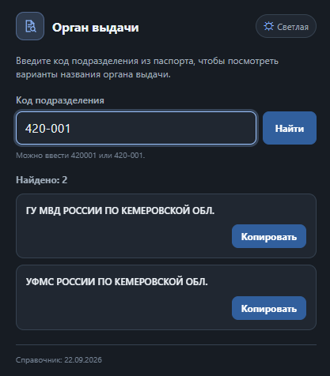
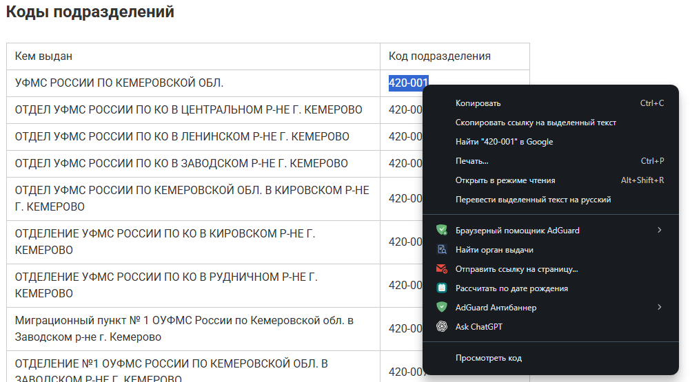
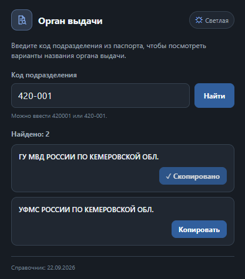

# Орган выдачи по коду

Chrome-расширение для поиска названия органа выдачи паспорта по коду подразделения. Показывает все известные варианты и позволяет быстро скопировать нужный.



[**Скачать последнюю версию для Chrome**](https://github.com/svsharav-afk/passport-issuer-by-code/releases/latest)

Текущая версия: **1.0.0**.

## Возможности

- Автоматически форматирует шестизначный код: `420001` → `420-001`.
- Запускает поиск после ввода или вставки полного кода. Поиск также можно запустить клавишей Enter или кнопкой **Найти**.
- Показывает все найденные варианты названия, каждый — отдельной карточкой.
- Позволяет скопировать название органа без кода и дополнительного текста.
- Поддерживает тёмную и светлую темы.
- Работает со встроенным локальным справочником.

## Как пользоваться

Введите код подразделения из паспорта — с дефисом или без него. Когда введены все шесть цифр, поиск выполнится автоматически. Для повторного поиска можно нажать Enter или **Найти**.

### Поиск через контекстное меню

Выделите на странице код `420001` или `420-001`, нажмите правую кнопку мыши и выберите **Найти орган выдачи**. Расширение откроет popup с подставленным кодом и результатами.



### Копирование названия

Нажмите **Копировать** в карточке нужного варианта. Кнопка ненадолго покажет **✓ Скопировано**.



## Установка в Chrome

1. Скачайте ZIP из раздела [последнего релиза](https://github.com/svsharav-afk/passport-issuer-by-code/releases/latest) и распакуйте его.
2. Откройте `chrome://extensions` и включите **Режим разработчика**.
3. Нажмите **Загрузить распакованное расширение** и выберите распакованную папку, в которой находится `manifest.json`.

## Справочник

В расширение встроен срез открытого проекта [`hflabs/fms-unit`](https://github.com/hflabs/fms-unit/tree/7d2d9a2c196147c45e9c87975e212ade8a342f82), commit `7d2d9a2c196147c45e9c87975e212ade8a342f82`, дата данных — **22.09.2026**. Составитель в метаданных источника — **DaData.ru**. В справочнике сохранены все варианты названий для каждого кода.

Данные и производный runtime-набор распространяются по лицензии **CC BY-SA 4.0** с атрибуцией HFLabs / DaData. Это справочный набор данных, а не официальный публичный реестр МВД. Источник и условия использования описаны в [документации о данных](docs/DATA_SOURCES.md) и [лицензии данных](LICENSE-DATA.md).

Справочник хранится локально. Во время работы расширение не обращается к DaData, другим API или внешним серверам.

## Конфиденциальность и доступы

Расширение не собирает аналитику и не отправляет введённые коды или названия на сервер.

Запрашиваются только permissions:

- `clipboardWrite` — копирование выбранного названия;
- `contextMenus` — пункт меню для явно выделенного пользователем текста;
- `storage` — кратковременная передача кода из обработчика контекстного меню в popup через `storage.session`.

Расширение не получает доступ ко всему содержимому страниц и не использует `activeTab`, `scripting` или host permissions.

## Требования

Google Chrome **127 или новее**.

## Разработка

Требуется Node.js; внешние npm-пакеты для сборки и тестов не нужны.

```sh
node scripts/build-data.mjs
node --test
```

Сборщик готовит `data/fms-units.json` из закреплённого CSV и проверяет сохранность всех исходных строк.

## Лицензии

Исходный код расширения распространяется по [MIT License](LICENSE). Справочник и производные от него данные имеют отдельную лицензию [CC BY-SA 4.0](LICENSE-DATA.md); MIT License на эти данные не распространяется.
